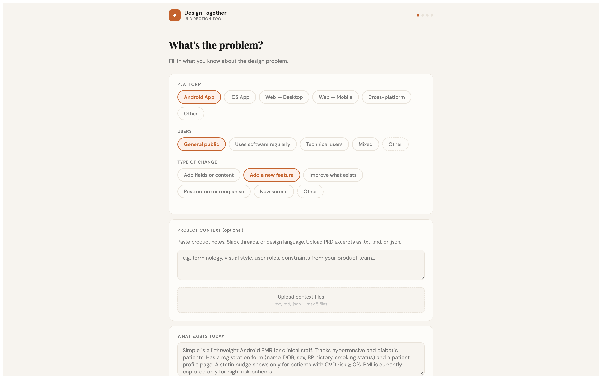
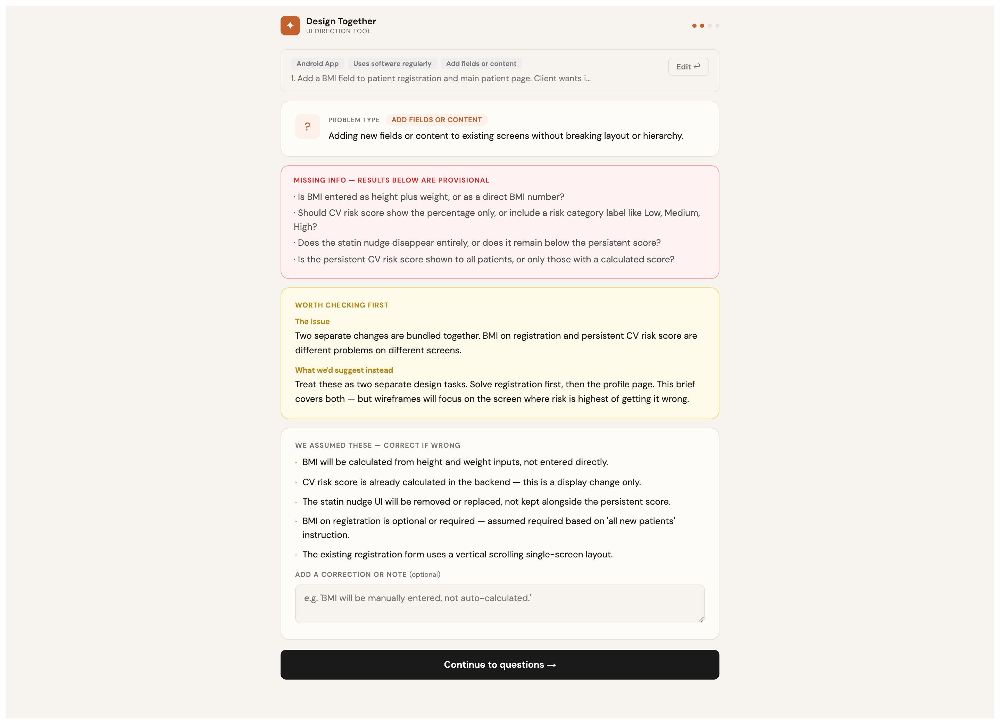
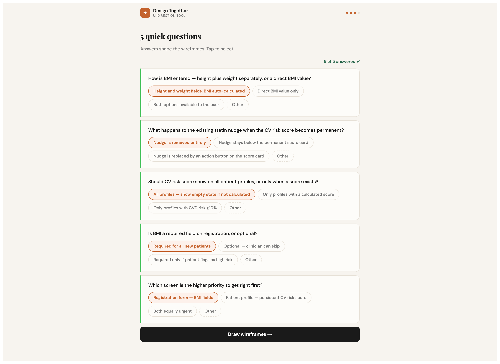
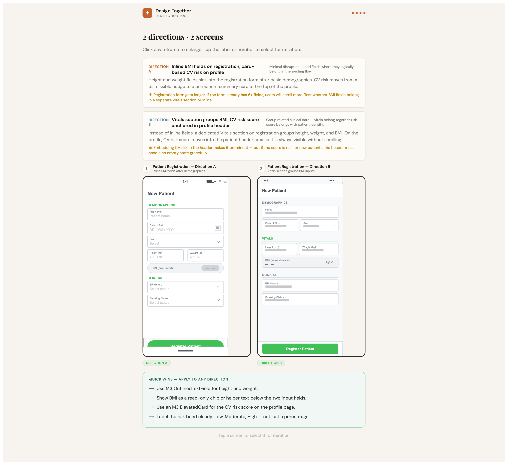
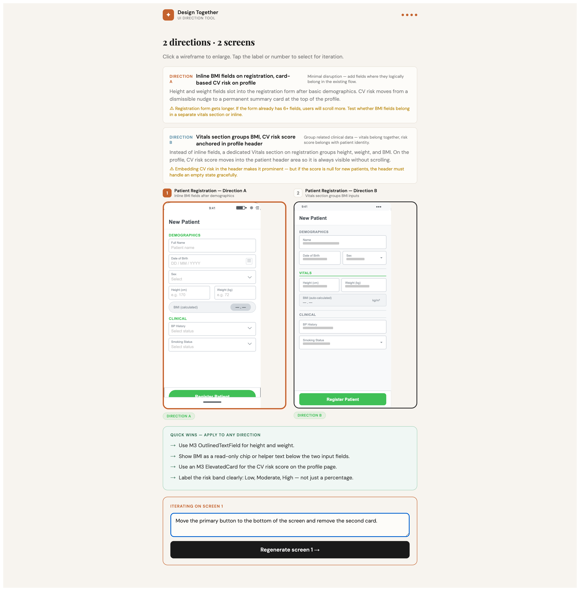

# Design Together

Design Together turns a short design brief into a UX analysis and two lo-fi wireframes, in a few minutes. You describe what exists and what needs to change. The app checks the request, suggests two design directions, asks a few questions and then draws one screen for each direction.

**Live app:** [design-together.vercel.app](https://design-together.vercel.app/) (private, passcode required)



---

## Why it exists

Change requests often arrive as one line, such as "add a BMI field to patient registration." Teams then jump straight to screens. Nobody checks whether the request makes sense, what was assumed or what other layouts could work. Drawing even two options by hand takes designer time, so usually only one gets drawn.

Design Together does that first pass for you. It pushes back on unclear requests, writes down its assumptions so you can correct them and shows two different layouts side by side. You get something concrete to discuss in the first meeting, not a week later.

**Who it's for:** product designers, product managers and developers who handle change requests on existing apps, mainly Android and mobile apps.

**What it's not:** a replacement for a designer or a design tool. The wireframes are rough sketches for early discussion. Refine the chosen direction in Figma or your usual tool.

---

## How it works

The app walks you through four steps, plus an optional fifth.

```
Brief → Analysis → Questions → Wireframes → (optional) Iterate
```

### 1. Write the brief

Pick the platform, the type of users and the type of change. Then describe **what exists today** and **what needs to change**. You can also add project notes, up to five PRD files (`.txt`, `.md` or `.json`, 500 KB each) and screenshots of the current app.

### 2. Review the analysis

The app returns:

- **Problem category** and a short description of the real problem
- **Pushback**, when the request needs reframing
- **Assumptions** it made, which you can correct in a note before moving on
- **Direction A** (a conventional layout) and **Direction B** (one structural change from A), each with a reason



### 3. Answer the questions

The app asks three to five questions that affect the layout. Each has preset answers plus "Other." You must answer all of them before the wireframes are drawn.



### 4. Compare the wireframes

Two phone-sized wireframes appear side by side, one per direction, for the same key screen. Click a wireframe to enlarge it.



### 5. Iterate (optional)

Select one or both screens, describe a visible change (for example, "move the primary button to the bottom") and regenerate. Only the selected screens are redrawn.



---

## Features

- **Pushback on the request** before any drawing starts
- **Editable assumptions:** correct what the app got wrong in plain text
- **Two directions** for every brief, so you compare options instead of approving one
- **Context from your files:** PRDs, notes and screenshots shape the terms, rules and patterns used
- **Lo-fi SVG wireframes** in a fixed grayscale style with one accent color
- **Targeted iteration** on one screen at a time
- **Private hosting** behind a passcode, so only people you share it with can use the API credit

---

## Tech stack

| Layer | Tool | Role |
|---|---|---|
| Front end | React 19, Vite 6 | Single-page app with the steps above |
| API | Node.js 18+, Express 4 | Builds prompts and calls Claude; keeps the API key out of the browser |
| AI model | Claude Sonnet 4.6 (Anthropic API) | Analysis, questions and SVG wireframes, returned as structured JSON |
| Hosting | Vercel | Serves the built app and runs the Express API as a serverless function |
| Access control | Vercel Routing Middleware | Asks for a passcode (browser login box) on every page and API call |

Runtime dependencies are `react`, `react-dom`, `express` and `dotenv`. There is no database. Nothing is saved between sessions.

### Architecture

```
Browser (React)
   │  every request
   ▼
middleware.js ── wrong or missing passcode ──▶ 401, login box
   │  passcode OK
   ├──▶ static files (built React app in dist/)
   └──▶ /api/*  ──▶  api/index.js  ──▶  server/index.js (Express)
                                            │
                                            ▼
                                     Anthropic API (Claude)
```

Each step makes a set number of calls to Claude:

| Endpoint | Claude calls | What it sends |
|---|---|---|
| `POST /api/analyze` | 1 | Brief, notes, PRD files and screenshots |
| `POST /api/wireframes` | 3 (one plan, then one per screen) | Brief, the two directions and your answers |
| `POST /api/iterate` | 1 per selected screen | The screen's layout notes, current SVG and your feedback |

Each call asks for JSON that matches a fixed schema (`server/schemas.js`), so the app can rely on the shape of every response. Design rules come from the markdown guides in `guides/`.

---

## Run it locally

You need **Node.js 18 or later** and an **Anthropic API key** from [console.anthropic.com](https://console.anthropic.com/).

```bash
git clone https://github.com/tonyjoyk/design-together.git
cd design-together
cp .env.example .env
```

Open `.env` and set your key:

```
ANTHROPIC_API_KEY=sk-ant-...
```

Then install and start:

```bash
npm install
npm run dev
```

Open **http://localhost:5173**. Local runs don't ask for a passcode.

`npm run dev` starts two processes:

- **Vite** (front end) on port 5173
- **Express** (API) on port 3001. Vite forwards `/api` requests to it.

**Troubleshooting**

- Wireframes fail with a connection error: another app may be using port 3001. Stop it and run `npm run dev` again.
- `ANTHROPIC_API_KEY is not set`: check that `.env` is in the project root, then restart.

### Production build

```bash
npm run build
npm start
```

This serves the built app and the API from one process.

---

## Deploy to Vercel (private, passcode-protected)

The live app asks for a passcode before it shows anything, so only people you share it with can use your Anthropic credit.

1. Sign in at [vercel.com](https://vercel.com) with GitHub. Give the Vercel GitHub app access to this repo only.
2. **Add New → Project** and import this repo. The Vite preset is detected automatically.
3. Before the first deploy, add these **Environment Variables** (Production and Preview):
   - `ANTHROPIC_API_KEY`: a key made just for this app, with a monthly spend limit set in the Anthropic Console.
   - `APP_PASSCODE`: a long passcode, for example four random words.
4. Deploy. Every push to `main` redeploys.

Opening the link shows the browser's login box. Type any username and the passcode. To change the passcode, update `APP_PASSCODE` in Vercel and redeploy.

---

## Tips for better results

- A short, focused brief works better than a large PRD with no summary.
- Screenshots are used only in the analysis step, where they help most.
- When iterating, ask for a visible change, such as "remove the second card."

---

## Known issues and limits

**Narrow pattern coverage.** The design knowledge comes from three markdown guides in `guides/`, not a full design system. Results are strongest for Android and mobile screens. Desktop web, iOS-specific and complex patterns may come out generic. Treat the output as a sketch.

**Generation can fail.** Each wireframe run makes three Claude calls, so you may hit rate limits. Wait about 30 seconds and try again. Very large PRDs or many screenshots can slow down or break the analysis step, so shorten the brief.

**Other limits:**

- Two wireframe screens per run (Direction A and B of the same screen)
- No saving: refreshing the page loses your session
- Iteration sometimes misses subtle feedback. Ask for a visible layout change and try again.
- The live app rejects requests over 4.5 MB. Screenshots are shrunk before upload, but several large PRD files can still go over.

---

## Data and privacy

- Brief text, uploaded files and screenshots are sent to the **Anthropic API** when you analyze, generate or iterate. Get approval before uploading confidential material.
- The app stores nothing on disk or in a database.
- Never commit `.env`. Only `.env.example` belongs in git.
- Keep the GitHub repo private.

---

## Repo structure

| Path | Purpose |
|------|---------|
| `src/` | React app |
| `src/prompts/` | System prompts for each step |
| `server/` | Express API: prompt building, Claude calls, JSON schemas |
| `guides/` | Design reference guides used in the prompts |
| `middleware.js` | Passcode check on Vercel |
| `api/index.js`, `vercel.json` | Runs the Express API on Vercel |
| `screenshots/` | Images used in this README |
| `docs/legacy/` | Old prototype, not used at runtime |

When you ask an AI agent to make changes, point it to [AI_RULES.md](AI_RULES.md).
